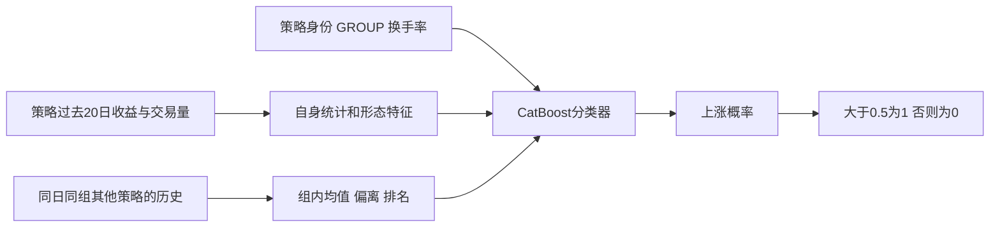

# 124维历史特征与 CatBoost 涨跌分类

我们在 [`market_forecaster.py`](../market_forecaster.py) 中实现历史特征构造与 CatBoost 分类。在505日、104,724行的开发验证集上，基线模型正确55,544行，准确率为 **53.0385%**；参数搜索选定的配置正确55,714行，准确率为 **53.2008%**。

## 1. 任务与输入



我们使用每条策略的20日收益与成交量历史，以及同日同组其他策略的历史统计，预测目标日收益方向。

## 2. 每行的124维特征

`AllocationFeatureProcessor.build()`先在允许使用的训练行中，为每个策略拟合收益标准差和换手率中位数。收益除以该策略的训练标准差；交易量经过`arcsinh`变换压缩极端值，保留正负号。

| 部分 | 维数 | 内容 |
|---|---:|---|
| 原始收益序列 | 20 | RET_20到RET_1，除以训练期策略尺度 |
| 原始交易量序列 | 20 | SIGNED_VOLUME的arcsinh变换 |
| 报告标记和换手率 | 3 | 最近日交易量是否有值、log10换手率、相对策略中位换手率 |
| 多窗口收益统计 | 30 | 2/3/5/10/20日，每窗6个统计 |
| 多窗口交易量统计 | 10 | 上述5个窗口的交易量均值和标准差 |
| 形态及交互项 | 13 | 波动比、趋势、尾部形态、价量相关、换手率交互等 |
| 同日同组相对状态 | 24 | 6个变量各产生组均值、偏离、z分数、百分位排名 |
| 策略覆盖数量 | 2 | 当日同组策略数、当日全部策略数 |
| 类别身份 | 2 | ALLOCATION和GROUP，按类别处理 |
| **合计** | **124** | 122个数值特征＋2个类别特征 |

每个收益窗口的6个统计是：均值、标准差、正收益比例、下行波动、均值/波动比、最近收益相对窗口均值的偏离。

交易量滚动统计统一排除最近一日。例如5日窗口取第2～5日的4个观测，20日窗口取第2～20日的19个观测。最近一日交易量仍作为单独原始特征输入，并附有效性标记；缺失数值填0。因此，滚动统计不会被最近一日的大面积缺失干扰。

## 3. 同日同组的相对特征

我们选择6个变量，即最近收益、5日均值、20日均值、20日波动、5日交易量均值和换手率对数。按匿名日期 `TS` 和市场组别 `GROUP` 分组，分别计算：

```text
组均值    = 这一天这一组策略的变量均值
偏离      = 当前策略变量 − 组均值
z分数     = 偏离 / 组内标准差
百分位排名 = 当前策略在这一组的位置
```

例如，同样是最近一天涨0.2%，在一个普遍涨1%的策略池里，它处于落后状态；在普遍下跌的策略池里，它则相对强势。这些关系让模型同时看到自身数值和横截面位置。

组内统计使用同一匿名日期的输入特征计算。

## 4. CatBoost 分类器

CatBoost逐棵叠加小型决策树。某条路径可以同时考虑“最近收益较高”“换手率较低”“组内排名靠前”“属于某类策略”等条件，从而学习状态之间的非线性组合。

将一条记录的特征向量记为 x，分类器的输出分数记为 F(x)，sigmoid 表示将分数转换为0至1之间概率的函数。

```text
分类分数 F(x) = 初始分数 + 学习率 × 各棵树的输出之和
上涨概率      = sigmoid(F(x))
```

训练使用二分类Logloss：预测方向错且过度自信时，惩罚更大。后续树逐步修正已有分类分数。

`ALLOCATION`和`GROUP`声明为类别，由CatBoost内部处理训练标签统计和类别划分，不把匿名策略编号当成可排序的连续数值。类别处理仅使用训练数据，不读取验证标签。

## 5. 基线模型与当前配置

| 参数 | 值 | 用途 |
|---|---:|---|
| `iterations` | 245 | 叠加245棵树 |
| `depth` | 7 | 树的最大深度 |
| `learning_rate` | 0.035 | 每棵树修正的步幅 |
| `l2_leaf_reg` | 10 | 抑制叶子输出过大 |
| `random_strength` | 1.5 | 增加分裂选择的随机性 |
| `border_count` | 64 | 数值变量的候选分箱数量 |
| `max_ctr_complexity` | 1 | 限制类别组合复杂度 |
| `random_seed` | 42 | 固定随机种子 |
| `thread_count` | 2 | 限制CPU训练与预测线程 |

上表为我们保存的基线模型参数。基线使用80%训练部分内部的404个日期选择参数，按内部二分类对数损失确定245棵树。后续参数搜索将迭代次数调整为118、学习率调整为0.04，其余表列参数保持一致。正式训练入口将线程数设为2，当前参数见 [forecasting.json](../configs/forecasting.json)。

## 6. 验证与比赛结果

我们按匿名日期划分训练与验证，同一日期的全部策略进入同一侧。特征尺度和类别学习使用训练部分，20%的日期用于开发比较，并在后续搜索中用于选择参数与迭代次数。基线与参数搜索结果分别保存在 [references/forecasting/metrics.json](../references/forecasting/metrics.json) 和 [runs/catboost_trials.json](../runs/catboost_trials.json)。

我们使用全部训练标签拟合官方预测模型，并提交 `submission-v1` 的31,870条测试预测，公榜分数为0.5140257295。提交结果保存在 [runs/submission-v1/metrics.json](../runs/submission-v1/metrics.json)。

## 7. 模块职责与执行流程

1. **`AllocationFeatureProcessor`** 拟合训练收益尺度，构造124列特征，并计算同日同组统计。
2. **`CatBoostDirectionModel`** 按训练标记选择拟合行，处理类别列，训练或加载分类器，并保存模型。
3. **`ForecastingPipeline`** 先构造特征，再训练或加载模型，最后将上涨概率写回原始查询行。
4. **`main()`** 解析参数，验证时生成80%／20%的日期划分，官方预测时使用全部训练标签拟合，并保存评分或提交文件。

各步骤通过原始行号保持特征、标签和预测结果的对应关系。

## 8. 环境和运行

我们将运行依赖列在 [requirements.txt](../requirements.txt)，包括 CatBoost 1.2.10、pandas 2.2.3 和 NumPy 2.5.3。基线模型的双线程 CPU 训练与评分记录约35秒，参数搜索耗时另行统计。安装及运行命令见 [README](../README.md)。

CatBoost使用两个CPU线程。本方法的数据读取与日期划分工具位于 `experiments.catboost.common`，历史重建另有独立的数据工具。

CatBoost 的类别处理和线程配置见[类别特征文档](https://catboost.ai/docs/en/features/categorical-features)与[线程参数文档](https://catboost.ai/docs/en/references/training-parameters/performance)。我们在配置、模型和运行记录中分别保存实验参数、训练结果及验证指标。
