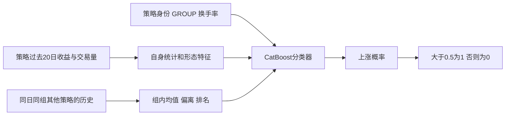

# 方案二：124维状态特征与CatBoost

程序：[`market_forecaster.py`](../market_forecaster.py)。同一份505日、104,724行验证集上，准确率为 **53.0385%**，55,544行正确。

## 1. 一行输入，直接预测它的下一日方向



模型使用给定的20日历史和同日策略池的X，预测下一日收益方向。

## 2. 每行的124维特征

`AllocationFeatureProcessor.build()`先在允许使用的训练行中，为每个策略拟合收益标准差和换手率中位数。收益除以该策略的训练标准差；交易量经过`arcsinh`变换压缩极端值，保留正负号。

| 部分 | 维数 | 内容 |
|---|---:|---|
| 原始收益序列 | 20 | RET_20到RET_1，除以训练期策略尺度 |
| 原始交易量序列 | 20 | SIGNED_VOLUME的arcsinh变换 |
| 报告标记和换手率 | 3 | 最近日交易量是否有值、log10换手率、相对策略中位换手率 |
| 多窗口收益统计 | 30 | 2/3/5/10/20日，每窗6个统计 |
| 多窗口交易量统计 | 10 | 上述5个窗口的交易量均值和标准差 |
| 形态及交互项 | 13 | 波动比、趋势、尾部形态、价量相关、换手率交互等 |
| 同日同组相对状态 | 24 | 6个变量各产生组均值、偏离、z分数、百分位排名 |
| 策略覆盖数量 | 2 | 当日同组策略数、当日全部策略数 |
| 类别身份 | 2 | ALLOCATION和GROUP，按类别处理 |
| **合计** | **124** | 122个数值特征＋2个类别特征 |

每个收益窗口的6个统计是：均值、标准差、正收益比例、下行波动、均值/波动比、最近收益相对窗口均值的偏离。

交易量滚动统计统一排除最近一日。例如5日窗口取第2～5日的4个观测，20日窗口取第2～20日的19个观测。最近一日交易量仍作为单独原始特征输入，并附有效性标记；缺失数值填0。因此，滚动统计不会被最近一日的大面积缺失干扰。

## 3. 组内相对状态怎么计算

程序选择6个变量：最近收益、5日均值、20日均值、20日波动、5日交易量均值、log换手率。对每个`(TS,GROUP)`分别计算：

```text
组均值    = 这一天这一组策略的变量均值
偏离      = 当前策略变量 − 组均值
z分数     = 偏离 / 组内标准差
百分位排名 = 当前策略在这一组的位置
```

例如，同样是最近一天涨0.2%，在一个普遍涨1%的策略池里，它处于落后状态；在普遍下跌的策略池里，它则相对强势。这些关系让模型同时看到自身数值和横截面位置。

这些聚合均由同日X计算。

## 4. CatBoost具体学了什么

CatBoost逐棵叠加小型决策树。某条路径可以同时考虑“最近收益较高”“换手率较低”“组内排名靠前”“属于某类策略”等条件，从而学习状态之间的非线性组合。

```text
分类分数 F(x) = 初始分数 + 学习率 × 各棵树的输出之和
上涨概率      = sigmoid(F(x))
```

训练使用二分类Logloss：预测方向错且过度自信时，惩罚更大。后续树逐步修正已有分类分数。

`ALLOCATION`和`GROUP`声明为类别，由CatBoost内部处理训练标签统计和类别划分，不把匿名策略编号当成可排序的连续数值。类别处理仅使用训练数据，不读取验证标签。

## 5. 当前固定参数

| 参数 | 值 | 用途 |
|---|---:|---|
| `iterations` | 245 | 叠加245棵树 |
| `depth` | 7 | 树的最大深度 |
| `learning_rate` | 0.035 | 每棵树修正的步幅 |
| `l2_leaf_reg` | 10 | 抑制叶子输出过大 |
| `random_strength` | 1.5 | 增加分裂选择的随机性 |
| `border_count` | 64 | 数值变量的候选分箱数量 |
| `max_ctr_complexity` | 1 | 限制类别组合复杂度 |
| `random_seed` | 42 | 固定随机种子 |
| `thread_count` | 2 | 限制CPU训练与预测线程 |

树深度和迭代数由80%训练部分内部的404个日期选定，按内部Logloss确定245棵树。当前程序固定这些参数。

## 6. 如何理解验证成绩

这份20%用于开发比较，官方公榜成绩尚未获得。同一日期的所有策略一起划分；特征尺度和类别学习只使用训练部分。

## 7. 按类逐步读代码

1. **`AllocationFeatureProcessor`**：训练尺度如何拟合；124维特征怎样逐块构成；哪些统计按当前日期分组。
2. **`CatBoostDirectionModel`**：模型参数、类别列、训练行选择、二线程预测、模型文件保存。
3. **`ForecastingPipeline`**：先拟合特征，再训练或读取模型，最后将概率放回原始查询行。
4. **`main()`**：验证时恢复原80/20划分；官方预测时用全体训练标签重新拟合；只将结果保存到本地。

逐步学习时，可以跟踪输入特征、训练行边界、类别处理和预测文件的行号对应关系。

## 8. 环境和运行

本次实测复用了本机已有Python3.12环境及CatBoost1.2.10、pandas2.2.3、NumPy2.5.3，没有安装新依赖。两线程CPU训练选参后的模型并评分约35秒；搜索对照另计。运行命令见[数据与运行说明](../README.md)。

CatBoost使用两个CPU线程。本方法的数据读取与日期划分工具位于 `experiments.catboost.common`，历史重建另有独立的数据工具。

库的原理与参数可对照[CatBoost类别特征说明](https://catboost.ai/docs/en/features/categorical-features)和[线程参数说明](https://catboost.ai/docs/en/references/training-parameters/performance)。本项目的特征构造、数据划分和结果以保存的代码与记录为准。
